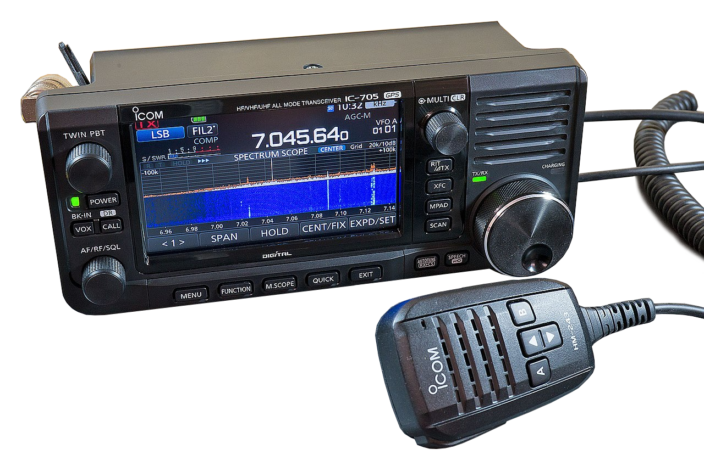

# HamTech M0FXB Modification — IC-7100 Photo Console v0.6

A Raspberry Pi 4 control panel for the **Icom IC-7100**, using a real IC-705 photograph, a live display and USB CI-V control. Designed for Debian 13 ARM64. Independent software; not endorsed by Icom.

This is the complete application. No previous version is required. There is no demo mode or simulated signal source.

## Fresh installation

Download `HamTech-M0FXB-IC7100-Complete-v0.6.zip` into your Pi's Downloads folder. Stop any old panel server with Ctrl+C. Copy and paste:

```bash
sudo apt update
sudo apt install -y unzip
mkdir -p "$HOME/HamTech-v06"
unzip "$HOME/Downloads/HamTech-M0FXB-IC7100-Complete-v0.6.zip" -d "$HOME/HamTech-v06"
cd "$HOME/HamTech-v06/ic7100-panel"
bash install-and-start.sh
```

Run as your normal desktop user. The installer asks for sudo when installing packages, creates a Python virtual environment, installs dependencies, adds serial permissions when needed and creates an application-menu shortcut. Internet access is needed for installation. If it adds you to `dialout`, log out and back in, then start again.

Open **http://127.0.0.1:7100** in Chromium on the Pi. Keep the server terminal open. Later launches:

```bash
cd "$HOME/HamTech-v06/ic7100-panel"
bash start-panel.sh
```

Keep the extracted folder in place so the menu shortcut remains valid. To install without launching: `bash install.sh`.

## USB connection

Connect the IC-7100's rear USB socket to a USB port on the Pi with a USB data cable. Keep the radio's original control head connected. Match these radio CI-V settings:

- Baud rate: **19200**.
- CI-V address: **88h**.

The application automatically selects a unique IC-7100 **A** serial interface under `/dev/serial/by-id`. It does not contain an owner's serial number. To see the device names:

```bash
ls -l /dev/serial/by-id/
```

For a different port or baud rate, replace the example device path:

```bash
bash start-panel.sh --port /dev/serial/by-id/YOUR_IC7100_A_DEVICE --baud 19200 --address 88
```

Use the A interface for CI-V, not the B data/GPS interface. Close other programs using the same port. SET → RECONNECT USB reopens the configured port. If access is denied:

```bash
sudo usermod -aG dialout "$USER"
```

Then log out and back in. The server listens on the Pi's local loopback interface.

## What is included

| Control | Behaviour |
| --- | --- |
| Frequency | Larger full-width frequency display. Click it to type MHz or select a band. |
| Band selection | 160m, 80m, 60m, 40m, 30m, 20m, 17m, 15m, 12m, 10m, 6m, 4m, 2m, 70cm and airband presets. Radio model and regional restrictions still apply. |
| AIR | One-touch 118.000 MHz AM, VFO mode, 25 kHz tuning step. |
| VFO knob | Drag the photographed dial, use its mouse wheel or arrow keys. On-screen +/− buttons also tune. |
| Tuning step | 10 Hz, 100 Hz, 1 kHz, 10 kHz and 25 kHz. QUICK cycles the available steps. |
| Meter | Click the meter to choose Signal, Power or SWR. Measurements come from the radio's CI-V replies. |
| Filters | FIL1 / FIL2 / FIL3, using the radio's existing filter presets. |
| NR / NB | Direct on/off buttons, plus level controls in Settings. |
| SHIFT | Off, negative or positive repeater shift, with editable offset in MHz. |
| TONE | 50 standard CTCSS frequencies, transmit tone and receive tone-squelch settings. |
| VFO / MEMORY | Select VFO A, VFO B or memory mode. Preview and recall stored channels 1–99 in banks A–E. |
| Audio waterfall | Real received USB audio FFT; no generated signals. |
| RF SWEEP | Pi-driven, 61-point receiver sweep using actual S-meter samples. |
| Display | Black surround, automatic fit, size slider, resize handle, screen-only view, expanded scope and fullscreen. |

### Signal / Power / SWR meters

Signal strength is polled through CI-V command `15 02`, using the manual's S0, S9 and S9+60 anchors. Intermediate readings are interpolated.

Power uses `15 11`, displayed as a percentage of the radio's meter scale, **not calibrated watts**. SWR uses `15 12`, with interpolation between the documented 1.0, 1.5, 2.0 and 3.0 anchors; readings above that scale show ≥3:1. These numeric conversions are approximate.

Power and SWR show **TX only** during reception. They update when the radio is transmitting through its normal controls. The application does not key the transmitter. Missing or rejected meter replies display — and errors in Settings rather than fake readings.

### Frequency entry and memories

Click the frequency, enter a value in MHz and apply, or tap a band preset. Band presets select VFO mode and a starting frequency/mode; they do not recall a band-stack entry.

VFO/MEM opens VFO A/B and memory controls. In the memory dialog choose bank and channel, READ to preview frequency/mode/name, then RECALL. Previous/next buttons browse adjacent memories. Empty channels are reported. This application does not write, erase or import stored memories.

The VFO/memory label records the last selection made by this application; it cannot reliably detect mode selections made on the physical control head through the published commands used here. Frequency and operating mode continue to read back from the radio.

### Repeater shift and CTCSS

SHIFT and TONE open the same repeater dialog. Choose shift direction, offset, TX tone, RX tone-squelch frequency and tone function, then APPLY. Unknown settings remain unchanged unless selected. Values are read back progressively; mode restrictions and rejected commands appear as errors.

### RF sweep and audio waterfall

The IC-7100 has its own native band-scope sweep on the control head. The published CI-V command set used here does not expose a command to trigger that native scope or retrieve its trace. **RF SWEEP is a separate Pi-driven receiver sweep**, not the native IC-705 scope or a remote press of the IC-7100 scope button.

It selects VFO mode, steps through 61 frequencies around the VFO centre, reads real S-meter values, draws a trace and attempts to restore the centre afterwards. Available total spans are 6, 30, 60, 300 and 600 kHz. The receiver audio changes as it tunes. STOP requests centre restoration. Controls are blocked during the sweep/restoration. TX detection stops the sweep and delays restoration until RX. A USB failure can prevent restoration; the error is shown. Selecting a trace point afterwards tunes that frequency. Sweeping from memory mode switches to VFO and uses its frequency.

The RF view is a sampled trace and colour strip, not a continuously updated RF waterfall. AUDIO SCOPE returns to the live USB AF waterfall.

For the audio waterfall set the radio's **ACC/USB Output Select to AF**, with a suitable AF output level. CI-V carries control data; audio arrives through the separate USB audio device. Automatic input selection needs a unique supported USB/Icom input. If necessary:

```bash
cd "$HOME/HamTech-v06/ic7100-panel"
.venv/bin/python -m sounddevice
```

Stop the server and restart with the capture-device index shown by that command, replacing `3`:

```bash
bash start-panel.sh --audio-device 3
```

The input must support mono 48 kHz capture. Settings shows audio errors and RMS/peak levels. Waterfall floor, ceiling, reference, AF span and trace smoothing adjust display sensitivity. HOLD freezes audio scope history. The AF waterfall represents the received passband, not a wideband RF view.

## Settings

Settings are read progressively; — means not yet read or unavailable. Supported options include:

- NR on/off and strength; NB on/off and level.
- Preamplifier, attenuator and AGC speed.
- Automatic notch; manual notch, width and position.
- DSP filter shape; filter preset selection.
- Radio AF volume, RF gain and squelch.
- Twin PBT inner/outer; CW pitch; RTTY twin-peak filter.
- Dial lock, CTCSS transmit tone, tone squelch and voice squelch.
- USB reconnect and connection details.
- Waterfall floor/ceiling, trace smoothing, AF span/reference and audio levels.
- Display preference reset, view, size, expanded scope and tuning step.

Level controls use raw CI-V 0–255 units. Valid settings depend on the radio's mode/band. The radio enforces its restrictions. Browser preferences are saved locally in that browser.

## Photograph

The bundled source photograph below is **not a screenshot of the running application**. The panel uses this actual photograph with a live LCD overlay and a draggable dial. A runtime screenshot has not been captured for this release.



Photo: Batchman99; derivative: VORON SPb. CC BY-SA 4.0. Attribution, source links and adaptation licensing are in [ATTRIBUTION.md](web/assets/ATTRIBUTION.md) and [THIRD_PARTY_NOTICES.md](THIRD_PARTY_NOTICES.md). Application code is MIT licensed. Preserve the photograph's separate license when sharing.

## Share on GitHub

Create a GitHub repository. Upload the **contents of `ic7100-panel`** into its root, including `web/assets`, all scripts, README and license files. Git users can commit this folder normally. Do not upload `.venv`, Python caches or personal configuration. The included `.gitignore` excludes local generated files.

Attach the complete ZIP to a GitHub Release for users who want the download-and-install route. Uploading only a ZIP to the repository does not expose browsable source. Dependencies are installed by the installer rather than bundled as offline binaries.

## Development status

The previous version worked on the owner's Pi. This release implements additional controls but **no tests, browser checks or hardware tests were run**, following the owner's instruction. Treat new CI-V behaviour, meter conversions, memory parsing and photo/control alignment as awaiting confirmation on an IC-7100. No PTT, native RF spectrum stream, arbitrary filter-bandwidth editing or automatic boot service is included.

Protocol reference: Icom IC-7100 Advanced Instructions, section 20 (Control Commands), including frequency/mode, meters, duplex offset, tone frequency and memory data. Manufacturer product/manual listing: https://www.icomjapan.com/lineup/products/IC-7100EUR/
